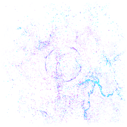
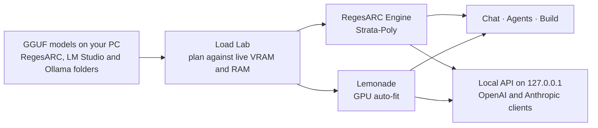
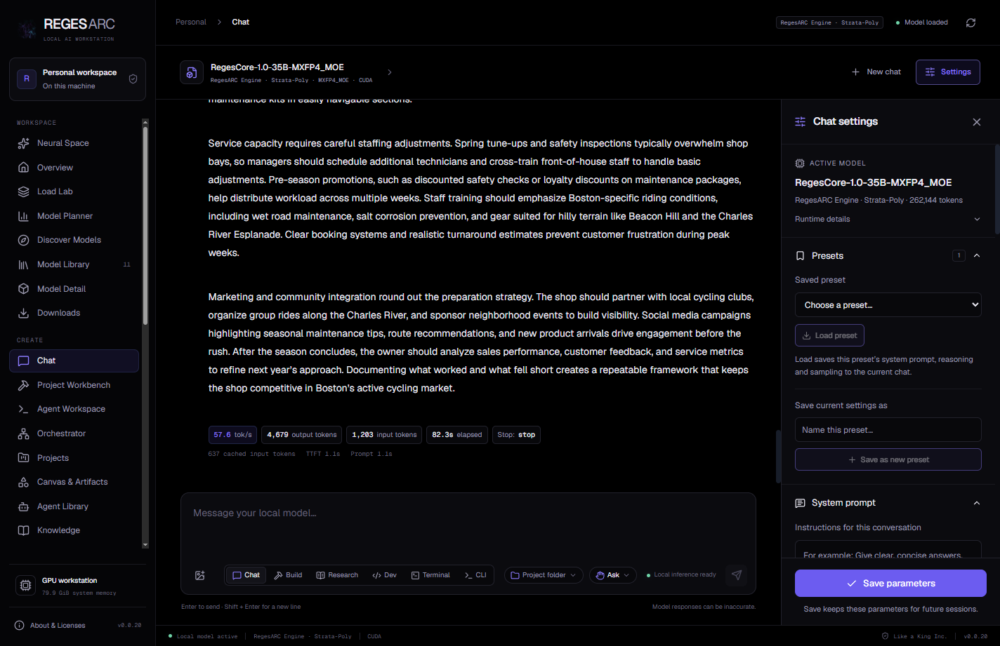
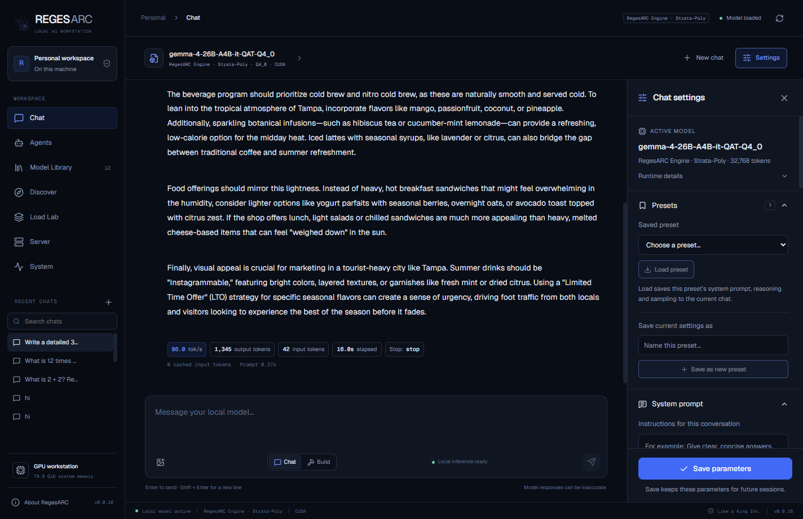
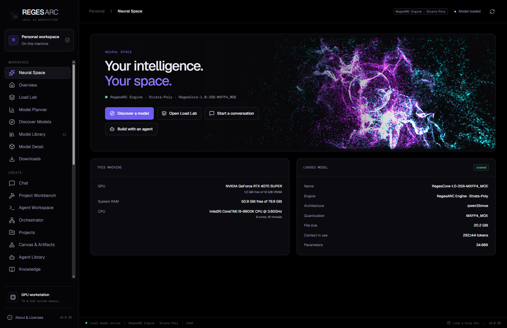

<p align="center"></p>

<h1 align="center"> RegesARC</h1>

<p align="center"><b>A local AI workstation for Windows. Your models. Your machine.</b></p>

<p align="center">
<a href="https://github.com/iboss21/regesarc-releases/releases"></a>
<a href="https://github.com/iboss21/regesarc-releases/releases"></a>

<a href="https://regesarc.com"></a>
<a href="https://likeakinginc.com"></a>
</p>

<p align="center"><a href="https://regesarc.com"></a></p>

<p align="center">
<a href="https://github.com/iboss21/regesarc-releases/releases"><b>⬇️ Download for Windows</b></a> ·
<a href="#-verify-the-download">Verify</a> ·
<a href="https://regesarc.com/#download">regesarc.com</a>
</p>

## 🗺️ Map

[What it is](#-what-regesarc-is) · [Measured speeds](#-measured-speeds) · [Features](#-features) · [Claude Code and Claude Desktop](#-use-with-claude-code-and-claude-desktop) · [Download](#%EF%B8%8F-download) · [Verify](#-verify-the-download) · [Requirements](#%EF%B8%8F-system-requirements) · [Install](#-install-and-uninstall) · [License](#-license-and-credits)

## 🌌 What RegesARC is

RegesARC runs large AI models on your own Windows PC. It reads the GGUF files you already have, plans how they fit in your GPU memory and system RAM, loads them in the right engine, and gives you a chat, agents and a local API on top.

- **RegesARC Engine · Strata-Poly** runs big mixture-of-experts models, such as **RegesCore-1.0-35B** and **Gemma 4**, on a 12 GB graphics card. It fills free VRAM with the experts a model uses most and runs the rest on the CPU. Every expert and every selected route is kept; nothing is pruned or skipped.
- **Lemonade** runs everything else, and fits a model's layers to your GPU automatically.
- **Load Lab** checks a plan against your real free memory before anything loads. If a plan doesn't fit, RegesARC says so; it never quietly cuts your context or cache.



## 📈 Measured speeds

Measured on one machine: an **NVIDIA RTX 4070 SUPER 12 GB** with an Intel Core i9-9900K and 80 GB of RAM, writing speed in tokens per second. These are results from that PC, not promises for other hardware.

| Model | Engine | Context | Writing speed |
| --- | --- | ---: | ---: |
| RegesCore-1.0-35B MXFP4 | RegesARC Engine · Strata-Poly | 262,144 | **57.7–64.6 tok/s** |
| RegesCore-1.0-35B Q8_0 (from BF16) | RegesARC Engine · Strata-Poly | | **48–53 tok/s** after the first answer |
| Gemma 4 26B A4B (QAT Q4_0) | RegesARC Engine · Strata-Poly | 32,768 | **about 82 tok/s** (86 in the screenshot below) |
| RegesCore BF16 (experimental opt-in) | RegesARC Engine · Strata-Poly | | **4–9 tok/s** |

**Quality:** on the graded quality set, RegesCore MXFP4, Q8_0 and BF16 all scored **72 of 80**, and Q8_0's answers match BF16's token for token.

<table>
<tr>
<td width="50%" valign="top">

<sub>RegesCore-1.0-35B MXFP4 at 262,144 tokens of context: 57.6 tok/s on a 4,679-token answer, in the installed 0.0.20 app. The chat box shows the work modes, project folder and permission mode.</sub>
</td>
<td width="50%" valign="top">

<sub>Gemma 4 26B A4B in Strata-Poly: 86.0 tok/s on a 1,345-token answer, in the installed 0.0.16 app.</sub>
</td>
</tr>
</table>

## ✨ Features

<p align="center"><br><sub>Neural Space in the installed 0.0.20 app: the nebula, this PC's hardware and the loaded model.</sub></p>

**In the current download (0.0.22):**

- 🔄 **Updates itself.** From 0.0.20 on, RegesARC checks for a new version, downloads it in the background, checks its SHA-256, and offers **Restart to update**. Versions before 0.0.20 need the current installer once, by hand.
- 🤝 **Works with Claude Code and Claude Desktop:** both can use RegesARC as their model (see [below](#-use-with-claude-code-and-claude-desktop)).
- 👀 **The agent sees and debugs:** paste screenshots into Build, Dev, Research and Terminal; it reads a page's console, network requests, elements and performance, and captures up to 30 frames to see motion.
- 🖱️ **Computer use, off until you turn it on:** per conversation, every click and keystroke asks first, secrets are never typed, and **Esc** or **Ctrl+Alt+Q** stops it at once.
- 📚 **Learns and remembers:** lessons from failed-then-fixed runs, successful runs saved as skills (off until you turn them on), and a graph memory of your projects kept on your PC.
- ✅ **The agent checks its own work:** in Build and Dev, a run that changed files runs the build or tests, or looks at the page, before it reports done.
- 🧭 **Work modes:** Chat, Build, Research, Dev, Terminal and CLI, remembered per conversation, with a **project folder** and a **permission mode** (Plan, Ask, Accept edits, Auto, Allow all, Bypass) in every chat box.
- ⌨️ **A Zed-style terminal workspace,** written on RegesARC's own code.
- 🖥️ **The `regesarc` CLI:** run the agent from any terminal against your local model, like `claude -p`, with modes and approvals.
- 🔌 **MCP and skills discovery:** the MCP servers and skills you already set up in other apps, found and listed in place.
- 🧩 **Plugins and connectors:** sandboxed local plugins, plus GitHub, Hugging Face, Google Drive, Slack and REST connectors with keys kept in Windows' key store.
- 🗺️ **Pages from the RegesARC preview:** Neural Space, Overview, Model Planner, Model Detail, Benchmarks, Runtimes, Setup, Projects, Canvas & Artifacts and more.
- 💬 **Rich chat:** Markdown answers with tables and code, links that ask before they open, pasted and attached files, a message queue, and live speed, token and cache stats on every answer.
- 🧠 **Big models on a small GPU:** RegesCore and Gemma 4 in Strata-Poly, Lemonade layer auto-fit for the rest, and full 262K context for RegesCore by default.
- 🖼️ **Images:** RegesCore reads images in Strata-Poly.
- 🗂️ **Finds your models where they are:** RegesARC's own folder, LM Studio's folders and Ollama's models, read in place.
- 🛰️ **Server page and local API:** an OpenAI- and Anthropic-compatible API on 127.0.0.1, with connected clients, a live request log and request details.
- 🎨 **Eleven themes,** from Night, Day and Crimson to Ocean, Ember and High contrast.

## 🤝 Use with Claude Code and Claude Desktop

RegesARC's local API speaks Anthropic's Messages API, so Claude Code and Claude Desktop can run on your local model.

### Claude Code

1. In RegesARC, load a model and turn on the local API on the **Server** page. Note its port and API key.
2. Point Claude Code at it:

```powershell
$env:ANTHROPIC_BASE_URL = "http://127.0.0.1:<port>"
$env:ANTHROPIC_AUTH_TOKEN = "<your RegesARC local API key>"
claude
```

- Claude Code's own tools, MCP servers, plugins and skills keep working, with the loaded model choosing which tool to call. In 0.0.22 QA, `claude -p` ran its Bash tool through RegesARC.
- Any model name Claude Code asks for is served by the model loaded in RegesARC.
- Anthropic's server-side tools, such as web search and code execution, don't work: they need Anthropic's servers.

### Claude Desktop

Claude Desktop's third-party inference can use RegesARC as its gateway:

- **Gateway URL:** `http://127.0.0.1:<port>`
- **API key:** your RegesARC local API key
- **Model names:** in RegesARC, open **Server → Local API** and give the loaded model the aliases Claude Desktop asks for (for example `claude-sonnet-4-5`). Every alias is listed in `/v1/models` and accepted on both the Anthropic and OpenAI routes.

Claude Desktop's connection check (`HEAD /api/hello`) answers without a key and says only "ok"; models and messages still need the key.

## ⬇️ Download

Get the installer from the [releases page](https://github.com/iboss21/regesarc-releases/releases).

| Version | File | Size | SHA-256 |
| --- | --- | --- | --- |
| 0.0.22 | `RegesARCSetup-x64-0.0.22.exe` | 1.34 GB (1,335,172,524 bytes) | `9de949495b1e3f81e15986db79ed00f99a4d736dfc8d83c19e111660ed06f5c5` |

> [!WARNING]
> **Unsigned development preview.** The installer is not code-signed yet, so Windows SmartScreen may warn before it runs ("More info", then "Run anyway"). Verify the SHA-256 before you run it. From 0.0.20 on, the app updates itself and checks each update's SHA-256 before installing it.

## 🔐 Verify the download

Each release includes `RegesARC-<version>-SHA256SUMS.txt`. Compare the installer's hash with it before you run the installer.

PowerShell:

```powershell
Get-FileHash .\RegesARCSetup-x64-0.0.22.exe -Algorithm SHA256
```

Command Prompt:

```
certutil -hashfile RegesARCSetup-x64-0.0.22.exe SHA256
```

The result must equal `9de949495b1e3f81e15986db79ed00f99a4d736dfc8d83c19e111660ed06f5c5` (letter case does not matter). If it differs, delete the file and download it again.

## 🖥️ System requirements

- **Windows 10 or Windows 11, 64-bit (x64).** Installs for the current user; no administrator rights needed.
- **An NVIDIA GPU is recommended,** with a current NVIDIA driver. The bundled GPU engine is built for GeForce RTX 40-series cards (CUDA sm_89) and was tested on an RTX 4070 SUPER 12 GB. Other GPUs have not been qualified.
- **About 2.2 GB of disk space** for the app, plus disk space and system memory for the models you use.
- **Models are not included.** RegesARC reads GGUF model files you already have. Each model keeps its own license.

## 📦 Install and uninstall

Run the installer. It installs to `%LOCALAPPDATA%\Programs\RegesARC` and keeps settings and conversations in `%APPDATA%\RegesARC`. Uninstall from Windows Settings > Apps. Uninstalling does not delete your model files.

## 👑 License and credits

RegesARC is proprietary software. Copyright © 2026 **LIKE A KING INC.**, New York. All rights reserved. See [LICENSE](LICENSE). Third-party components keep their own licenses: see [THIRD-PARTY-NOTICES.txt](THIRD-PARTY-NOTICES.txt) and the notices installed with the app.

This repository hosts the Windows installers only. The RegesARC source code is private.

<p align="center">
<a href="https://likeakinginc.com"><b>LIKE A KING INC.</b></a> · developed by <a href="https://davidio.dev">iBoss / Davidio</a> · <a href="https://github.com/iboss21">@iboss21</a> · <a href="https://x.com/RegesCoreAi">@RegesCoreAi</a>
</p>

<p align="center"><sub>Questions: <a href="https://www.likeakinginc.com/#enquiries">likeakinginc.com</a>. Please report security problems privately through <a href="https://github.com/iboss21/regesarc-releases/security/advisories/new">security advisories</a>, not in public issues.</sub></p>
